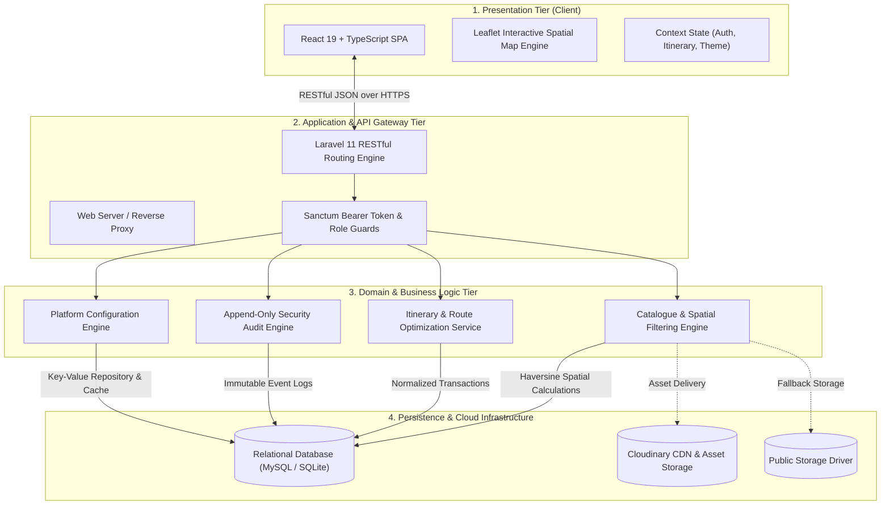
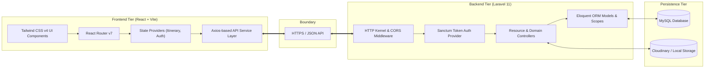
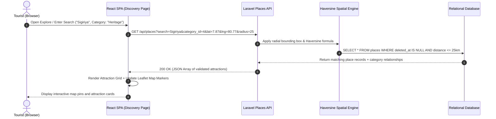
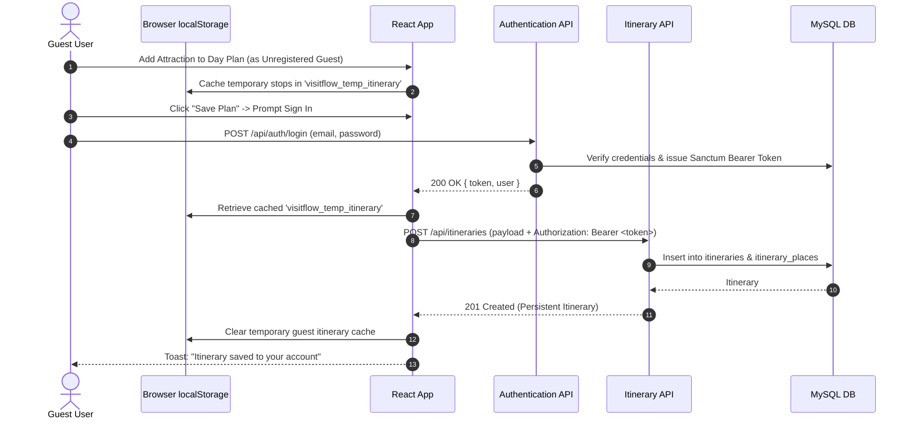
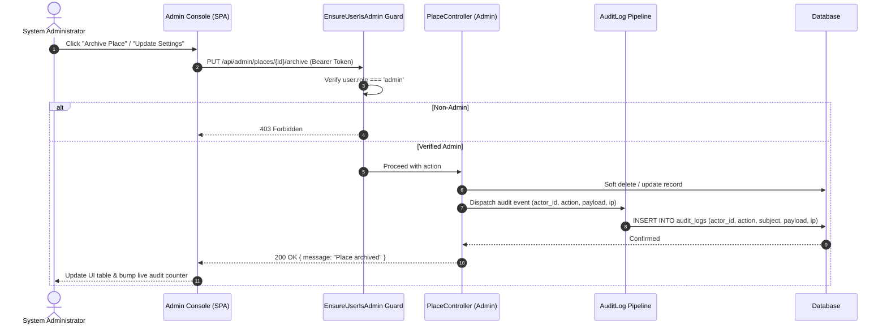
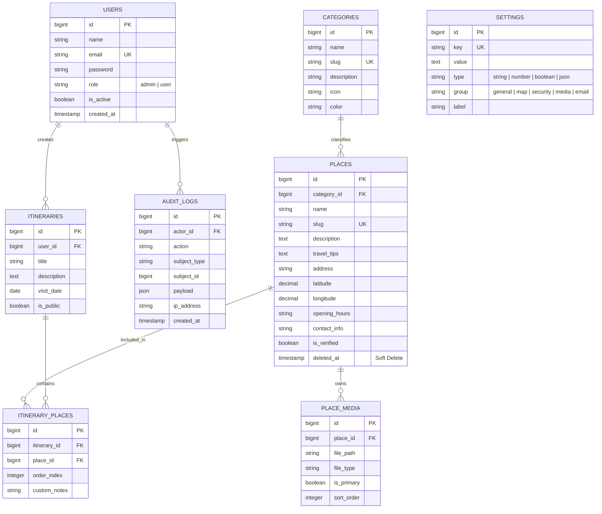
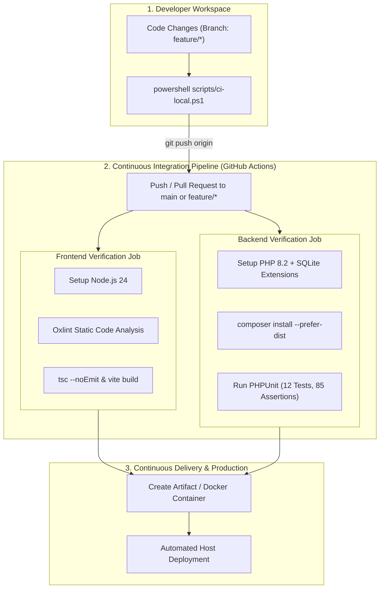

# VisitFlow — System Architecture Document

**Project:** VisitFlow — Curated Sri Lanka Day Visit Planning Web Application  
**Institution:** University of Moratuwa  
**Architecture Paradigm:** Decoupled Multi-Tier Client-Server Architecture (RESTful API & Single Page Application)  
**Document Version:** 1.0 (Production & Academic Baseline)  

---

## 1. Architectural Overview & Design Principles

VisitFlow is engineered as a decoupled, multi-tier web application designed to solve the problem of fragmented tourist information and disjointed route planning in Sri Lanka's tourism sector. The system follows clean architecture principles, separating concerns across presentation, domain logic, spatial geometry, and persistent storage.

### Core Architectural Principles
- **Separation of Concerns (SoC):** Strict demarcation between client-side routing, stateful user sessions, business rule enforcement, and relational persistence.
- **Stateless RESTful Communication:** Zero server-side session stickiness; client requests authenticate using cryptographic Bearer tokens (Laravel Sanctum).
- **Spatial Geometry First:** Built-in spherical trigonometry (Haversine Formula) dynamically bounds places within operational operational discovery envelopes (e.g., 25 km radius).
- **Graceful Offline/Guest Degradation:** Unauthenticated visitors can plan routes in-memory (`localStorage`), which transparently synchronize to persistent user records upon authentication.
- **Defensive Auditability:** Append-only audit trail captures every state-mutating administrative action with IP address and JSON payload snapshots.

---

## 2. Multi-Tier Component Breakdown

### 2.1 Presentation Tier (Frontend)
- **Framework & Language:** React 19, TypeScript 5.8, bundled with Vite 8.
- **Styling Architecture:** Custom design token system leveraging Tailwind CSS, using an Oceanic & Charcoal palette (`ivory-100`, `navy-950`, `turquoise-500`, `gold-500`).
- **Interactive Mapping:** Leaflet spatial rendering canvas (`react-leaflet` / Leaflet L.map) consuming OpenStreetMap raster tiles, rendering high-contrast SVG map pins, clustering, and route connection polylines.
- **State Management Architecture:**
  - `AuthContext`: Manages user credentials, role hierarchy (`guest`, `user`, `admin`), login states, and token persistence.
  - `ItineraryContext`: Handles optimistic one-day route builders, real-time stop reordering, drag/drop mutations, and local-storage syncing.
  - `ThemeContext`: Class-based dark/light mode engine avoiding first-paint flashes.
- **CRM Shell (Admin Console):** Standalone full-viewport administration workspace with KPI metric monitors, catalogue tables, taxonomy trees, media attachment modules, user permission toggles, and system telemetry cards.

### 2.2 Application & Logic Tier (Backend)
- **Framework:** Laravel 11 running on PHP 8.2+.
- **Routing & Controllers:**
  - **Public APIs:** `/api/places` (spatial search, keywords, category filtering), `/api/categories`, `/api/itineraries` (user CRUD & route sharing).
  - **Authentication APIs:** `/api/auth/register`, `/api/auth/login`, `/api/auth/logout`, `/api/auth/user`.
  - **Admin APIs (`/api/admin/*`):** Guarded endpoints for places CRUD, soft-delete archival, photo validation, user role escalation/deactivation, audit trail inspection, system health probes, and platform settings.
- **Haversine Distance Engine:**
  Evaluates geographical proximity directly in the query pipeline:
  $$\text{Distance} = 6371 \times 2 \times \arcsin\left(\sqrt{\sin^2\left(\frac{\Delta \text{lat}}{2}\right) + \cos(\text{lat}_1)\cos(\text{lat}_2)\sin^2\left(\frac{\Delta \text{lng}}{2}\right)}\right)$$
- **Automated SQLite Compatibility Layer:** Registered PDO trigonometric functions (`acos`, `cos`, `sin`, `radians`, `least`, `greatest`) ensuring 100% test parity between development SQLite in-memory databases and production MySQL environments.

### 2.3 Persistence Tier
- **Database:** Relational MySQL engine with foreign key constraints, indexes on spatial columns (`latitude`, `longitude`), unique slugs, and soft-delete markers (`deleted_at`).
- **Asset Storage:** Dual-driver media subsystem defaulting to local disk (`storage/app/public`) with seamless switchability to Cloudinary CDN for optimized WebP delivery and automatic thumbnail generation.

---

## 3. Data Flow & Dynamic Interactions

### 3.1 Tourist Discovery & Spatial Query Flow

### 3.2 Guest-to-Authenticated Itinerary Synchronization

### 3.3 Administrative Mutation & Audit Trail Pipeline

---

## 4. Entity-Relationship Architecture (Database Schema)

---

## 5. Security & Governance Architecture

1. **Authentication:** 
   - Stateful token-based authentication via **Laravel Sanctum**. Tokens are hashed (`SHA-256`) and stored in the database.
   - All protected client requests transmit the Bearer token via the HTTP `Authorization` header.
2. **Authorization Guards:**
   - Role-Based Access Control (`role: 'admin' | 'user'`).
   - `EnsureUserIsAdmin` middleware rejects non-privileged access attempts with HTTP `403 Forbidden` and logs security anomalies.
3. **Input Validation & Sanitization:**
   - Strict Laravel Form Requests (`StorePlaceRequest`, `UpdateSettingsRequest`).
   - Coordinate clamping ensuring latitudes ($5.9^\circ \text{N}$ to $9.9^\circ \text{N}$) and longitudes ($79.6^\circ \text{E}$ to $82.0^\circ \text{E}$) fall strictly within Sri Lankan geographical territory.
4. **Data Protection:**
   - Passwords hashed using standard `Bcrypt` with dynamic salt rounds.
   - Database credentials, API tokens, and secret keys managed through `.env` environment isolation (excluded from version control).
   - Sensitive fields in system settings (`mail_password`, `api_keys`) masked (`••••••••`) before API serialization.

---

## 6. Continuous Integration & Delivery (CI/CD) Architecture

VisitFlow incorporates a continuous integration and automated testing pipeline:
- **Linting & Hygiene:** High-speed Oxlint scans JavaScript/TypeScript files in sub-second times.
- **Frontend Compiles:** Strict TypeScript validation (`tsc -b`) and Vite production bundling.
- **Backend Test Suite:** 12 automated unit and feature test suites (85 assertions) running in an isolated SQLite in-memory database verifying authentication guards, guest synchronization, travel tips validation, radius boundary clamps, and soft deletion constraints.
- **Continuous Validation:** Every pull request and push to the remote repository runs through GitHub Actions, guaranteeing zero regressions before merging.
